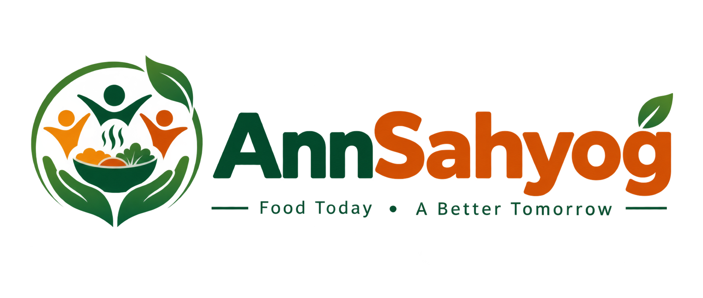
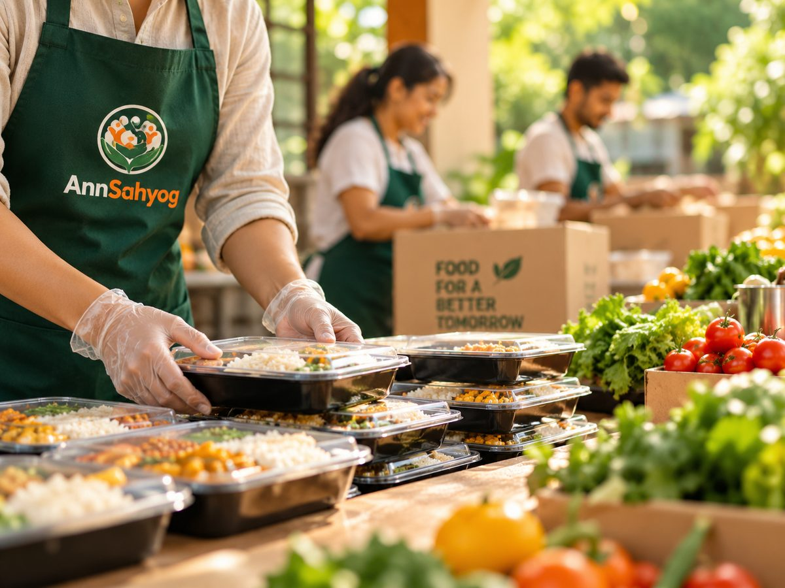
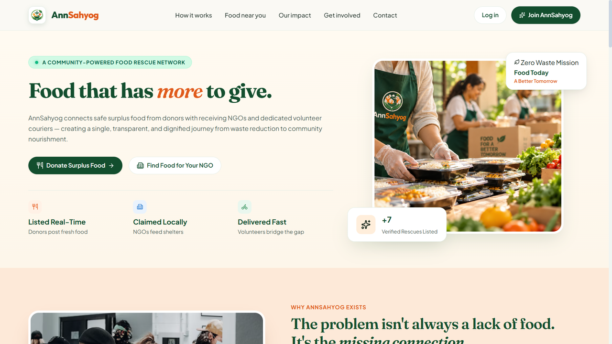
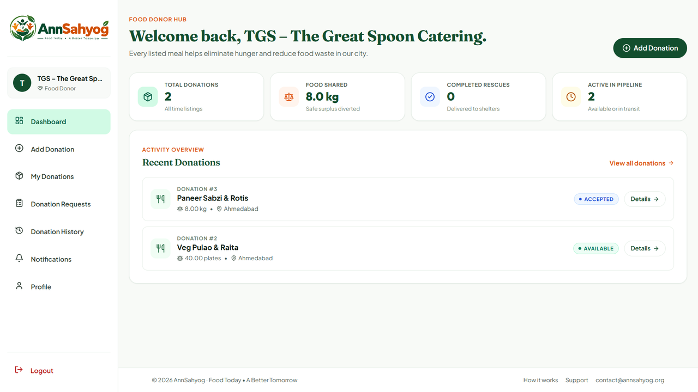
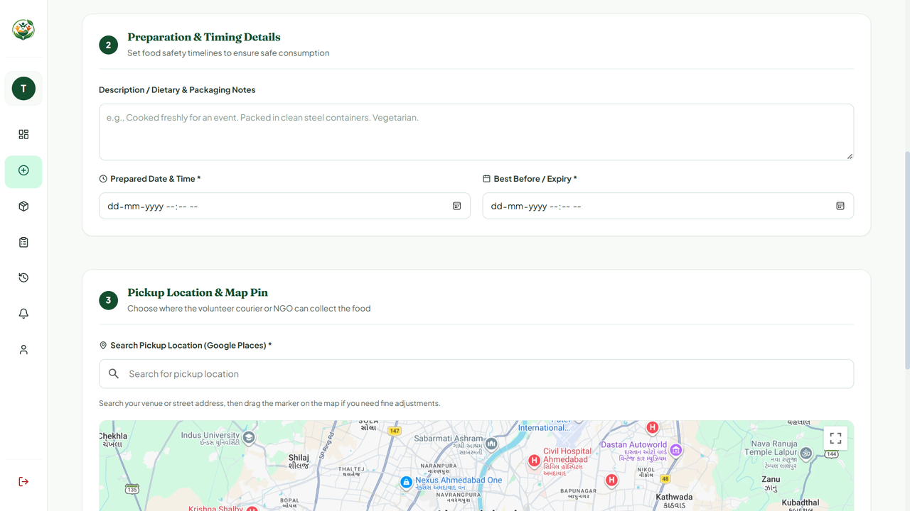
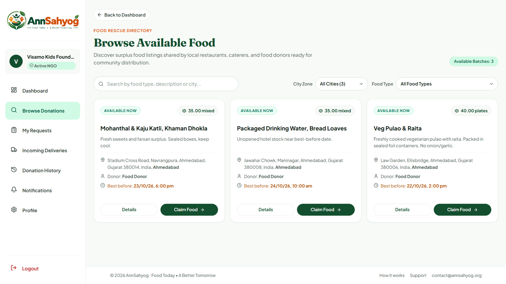
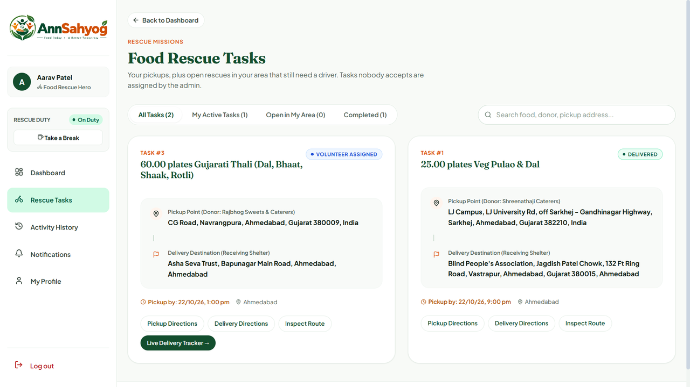
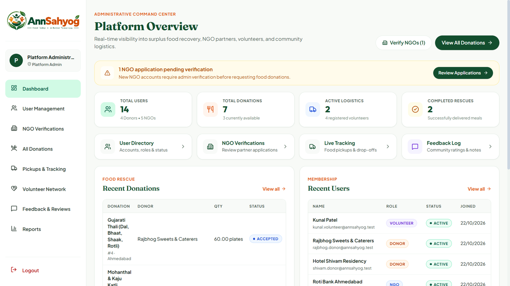

<div align="center">



### Connecting surplus food with the people who need it


</div>

<p align="center"></p>

AnnSahyog is a food redistribution and rescue network. It connects food donors (restaurants, households and events) with NGOs that need food, and with volunteers who collect and deliver it. Admins verify organisations and monitor every donation from listing to delivery.

**Contents:** [Features](#features) · [Screenshots](#screenshots) · [Tech Stack](#tech-stack) · [Why Docker and Testing](#why-docker-and-testing) · [Project Structure](#project-structure) · [Getting Started](#running-locally-without-docker) · [Docker](#running-with-docker) · [Testing](#testing)

## Features

| Role | What they can do |
|------|------------------|
| **Donor** | Post surplus food with items, quantities, preparation and expiry dates, and a pickup location on the map. Track requests from NGOs, view donation history, and manage their profile and notifications. |
| **NGO** | Register for verification, browse available donations on a map, request food, follow deliveries, and review request and donation history. |
| **Volunteer** | Set availability, accept pickup and delivery tasks, navigate to the pickup point, update task status, and view task history. |
| **Admin** | Verify and manage NGOs, users and volunteers, oversee all donations and pickups, read feedback, and generate reports. |

Every donation moves through the statuses `AVAILABLE → REQUESTED → ACCEPTED → PICKED_UP → DELIVERED` (or `CANCELLED`).

## Screenshots

<table>
  <tr>
    <td width="50%"><br/><sub><b>Landing page</b></sub></td>
    <td width="50%"><br/><sub><b>Donor dashboard</b></sub></td>
  </tr>
  <tr>
    <td><br/><sub><b>Post a donation with a pickup location on the map</b></sub></td>
    <td><br/><sub><b>NGO: browse available food</b></sub></td>
  </tr>
  <tr>
    <td><br/><sub><b>Volunteer: rescue tasks</b></sub></td>
    <td><br/><sub><b>Admin: platform overview</b></sub></td>
  </tr>
</table>

## Tech Stack

- **Frontend:** React 19, Vite, React Router, Lucide icons, Google Maps
- **Backend:** Node.js, Express 5, mysql2, bcrypt, dotenv, cors
- **Database:** MySQL 8
- **Deployment:** Docker and Docker Compose

## Why Docker and Testing

**Docker** packages the database, backend and frontend so the app runs the same way on any computer. There's no need to install Node.js or MySQL by hand, and every developer or evaluator uses the same versions. A single command (`docker compose up --build`) starts everything. See [Running with Docker](#running-with-docker).

**Testing** checks that the API keeps working after changes. The scripts in `testrun/` send real requests to the running backend. They cover registration and login, the donation workflow, and access control for protected pages. The results are saved to `testrun/results.md` and `testrun/results.json`, which support the test cases documented in the project report. See [Testing](#testing).

## Project Structure

```
AnnSahyog/
├── docker-compose.yml        Runs the database, backend and frontend together
├── annsahyog.sql/            Database table definitions (one file per table)
├── AnnSahyog/
│   ├── backend/              Express API (server.js, auth.js, db.js, policy.js)
│   ├── frontend/             React app (src/pages, src/components, src/services)
│   └── postman/              Postman API collections and environments
└── testrun/                  API and workflow test scripts
```

## Prerequisites

- Node.js 20 or later and npm (for running without Docker)
- MySQL 8 (for running without Docker)
- Docker Desktop (for running with Docker)
- A Google Maps API key (for the map features)

## Environment Variables

Create these files. Never commit them to Git.

**`AnnSahyog/backend/.env`**

```
DB_HOST=localhost
DB_USER=root
DB_PASSWORD=your_mysql_password
DB_NAME=annsahyog
AUTH_SECRET=a_long_random_string
```

**`AnnSahyog/frontend/.env`**

```
VITE_GOOGLE_MAPS_API_KEY=your_google_maps_key
```

## Running Locally (without Docker)

1. Create the database and import the table definitions:
   ```bash
   mysql -u root -p -e "CREATE DATABASE annsahyog;"
   ```
   Import your dump file into the `annsahyog` database.
2. Start the backend (it runs on port 5000):
   ```bash
   cd AnnSahyog/backend
   npm install
   npm run dev
   ```
3. In a second terminal, start the frontend (it runs on port 5173):
   ```bash
   cd AnnSahyog/frontend
   npm install
   npm run dev
   ```
4. Open http://localhost:5173.

## Running with Docker

1. Create `AnnSahyog/.env` with the root password and the Google Maps key:
   ```
   MYSQL_ROOT_PASSWORD=your_root_password
   VITE_GOOGLE_MAPS_API_KEY=your_google_maps_key
   ```
2. Start all services from the `AnnSahyog` folder:
   ```bash
   docker compose up --build
   ```
3. Import your database dump into the Docker database:
   ```bash
   docker compose exec -T db mysql -uroot -p"your_root_password" annsahyog < annsahyog_full.sql
   ```
   On Windows PowerShell, use this instead, because `<` isn't supported there:
   ```powershell
   Get-Content annsahyog_full.sql | docker compose exec -T db mysql -uroot -p"your_root_password" annsahyog
   ```
4. Open http://localhost:8080.

| Service | Address |
|---------|---------|
| Frontend | http://localhost:8080 |
| Backend API | http://localhost:5000 |
| MySQL | localhost:3307 (mapped to 3306 inside Docker) |

Stop the services with `docker compose down`. Add `-v` to also delete the database volume.

## Notes

- The frontend calls the backend at `http://localhost:5000/api`. The app works on the machine where the backend runs. Other devices on the network need that address changed in `frontend/src/services/api.js`.
- The backend and frontend ports must be free. Stop any other server using port 5000 before starting the backend.
- Seed scripts in `backend/` (`seedAdmin.js`, `seedNgo.js`, `seedVolunteer.js`) create test accounts. Set the values for `ADMIN_EMAIL`, `ADMIN_PASSWORD` and related variables in `.env` before running `seedAdmin.js`.
- `resetLiveDb.js` deletes data. Run it only on a database you are happy to clear.

## Testing

The scripts in `testrun/` call the running API:

```bash
cd testrun
node run-api-tests.js
node run-workflow-tests.js
```

Results are saved to `testrun/results.md` and `testrun/results.json`.

## Documentation

Postman collections for every API area are in `AnnSahyog/postman/`. Import the collection and environment files into Postman to try the endpoints.
